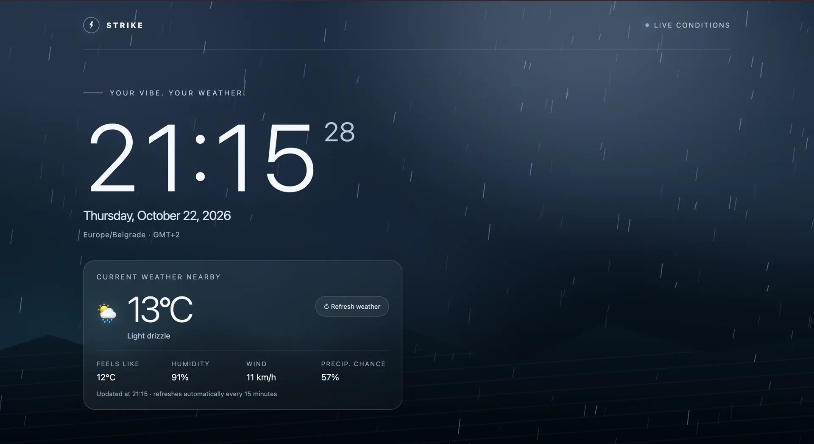
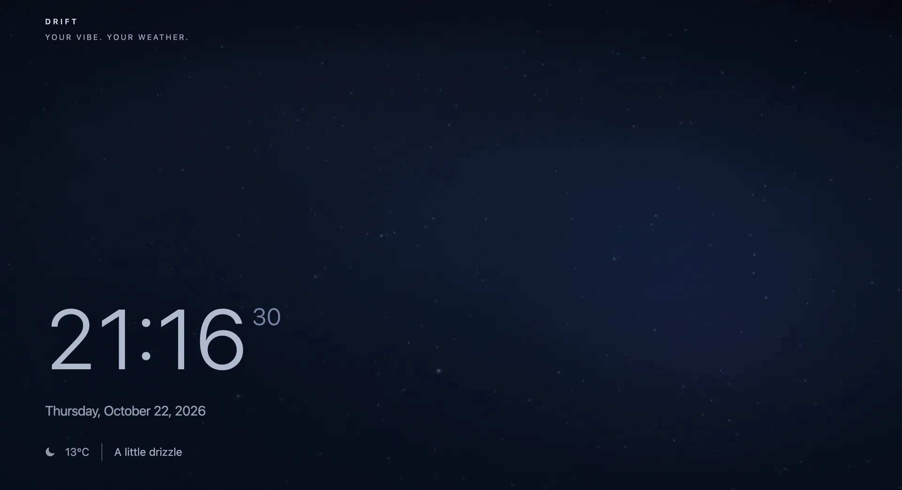

# Vibe Web Screensaver

**Your vibe. Your weather.**

A small collection of atmospheric web screensavers. Each one is a single static HTML page that turns weather and mood into a full-screen scene: motion, light, and a quiet clock. Leave one open on a spare monitor and let it set the mood.

These are not weather dashboards. Atmosphere comes first, and the interface is kept to what adds value to the scene.

| STRIKE | DRIFT |
| :---: | :---: |
|  |  |
| A cinematic thunderstorm | A quiet night sky to drift off under |

## Experiences

### STRIKE

A dramatic thunderstorm. Blurred storm clouds drift over a dark horizon, rain falls on a canvas, and procedural lightning flashes now and then, sometimes twice in a row. A glass-style card shows live local weather.

- Clock, date, and device time zone
- Temperature, feels-like, humidity, wind, and precipitation chance
- Manual refresh, plus an automatic refresh every 15 minutes
- Live demo: [strike.zhe700.space](https://strike.zhe700.space)

### DRIFT

A calm, clear summer night: lying on your back, watching the sky, starting to doze off. The sky is drawn from a catalogue of real bright stars and turns slowly around the pole star, one full turn every 30 minutes. A meteor crosses it now and then. Local cloud cover dims the stars, so a cloudy night really is dimmer.

- Clock, date, and the local temperature with a short, quiet description
- No controls and no clutter

## Features

- **Single file per experience.** One `index.html` with inline CSS, JavaScript, and SVG. No build step, framework, or dependencies.
- **Light on resources.** Animation pauses when the tab is hidden and resumes when it returns. The pages deliberately ignore window focus, so a screensaver visible on one monitor keeps running while you work on another.
- **Respects `prefers-reduced-motion`.** With reduced motion on, the scene renders a single still frame with no flashes.
- **Resilient weather.** Requests time out after 10 seconds and retry with backoff (1, 2, then 5 minutes). If an update fails, the last reading stays on screen, dimmed, and the page keeps working with no weather at all.
- **Photosensitivity-aware lightning.** STRIKE never produces more than two full-screen flashes per second.
- **Responsive and accessible.** Works from phones to large displays, with semantic HTML and keyboard-accessible controls.
- **No sound.**

## Quick start

1. Pick an experience: `strike` or `drift`.
2. Copy that folder's `index.html` to any static web host.
3. Open the page in a browser.

To try it locally, run a static server in the experience's folder:

```sh
cd strike
python3 -m http.server 8080
```

Then open `http://localhost:8080`. Browsers allow geolocation only on `localhost` or over HTTPS, so opening the file straight from disk will not fetch weather, and a deployed page needs HTTPS.

## Deployment

Any static host works: nginx, Caddy, GitHub Pages, Netlify, or object storage. Each page already ships a Content Security Policy as a `<meta>` tag. A real response header adds protections a `<meta>` tag cannot, such as `frame-ancestors`. An nginx example:

```nginx
server {
    listen 443 ssl;
    server_name strike.example.com;
    root /var/www/strike;
    index index.html;

    add_header Content-Security-Policy "default-src 'none'; script-src 'unsafe-inline'; style-src 'unsafe-inline'; img-src data:; connect-src https://api.open-meteo.com; base-uri 'none'; form-action 'none'; frame-ancestors 'none'" always;
    add_header Referrer-Policy "no-referrer" always;
    add_header Permissions-Policy "geolocation=(self), camera=(), microphone=()" always;
    add_header X-Content-Type-Options "nosniff" always;

    location / {
        try_files $uri /index.html;
    }
}
```

Adapt the TLS and hostname lines to your setup. Each page is a standalone site: run them on separate hosts or subdomains, as the original deployment does.

## Privacy

- Your browser asks for location permission. The page explains why and offers a retry if access is denied.
- Your coordinates are sent directly from your browser to [Open-Meteo](https://open-meteo.com) to fetch the weather, and nowhere else.
- There is no backend, analytics, tracking, accounts, cookies, or local storage.
- The Content Security Policy restricts network access to `api.open-meteo.com`.

## Data attribution

Weather data comes from [Open-Meteo](https://open-meteo.com), whose free API is licensed under [CC BY 4.0](https://creativecommons.org/licenses/by/4.0/) and intended for non-commercial use. If you deploy these pages publicly, check [Open-Meteo's terms](https://open-meteo.com/en/terms) and credit them accordingly. Their commercial plans are the right route for commercial use.

## Project structure

```
strike/index.html   thunderstorm experience
drift/index.html    night sky experience
screenshots/        preview images used in this README
```

The experiences share design principles but no code. Each one is fully self-contained, so it can be deployed on its own host without dependencies.

## Philosophy

Weather is more than numbers, icons, and forecasts. It can be a mood, a feeling, or an entire atmosphere. Vibe Web Screensaver explores that idea through minimal, immersive pages that bring the sky to your screen.

## Status

An ongoing personal project. New atmospheres may be added over time, each as its own small page.

## License

[MIT](LICENSE)
